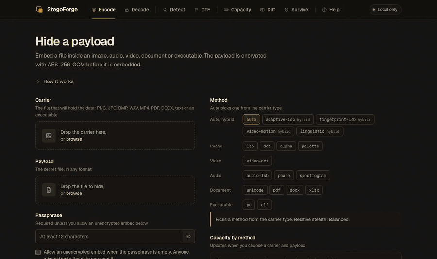
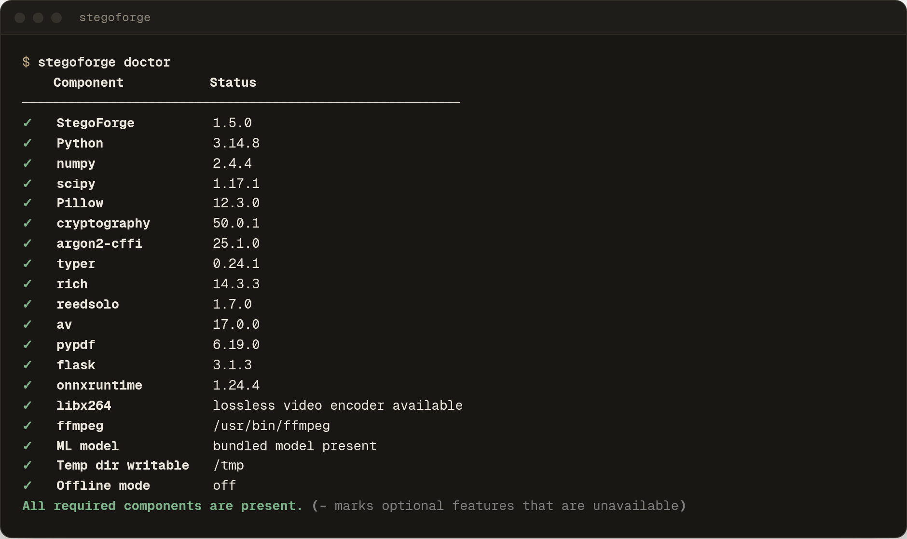
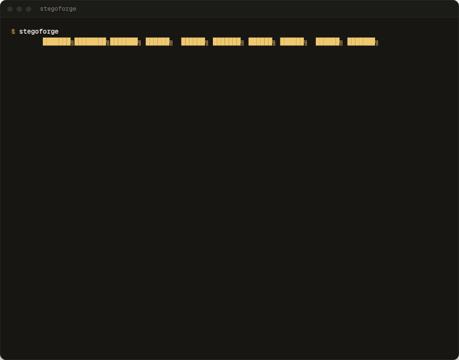
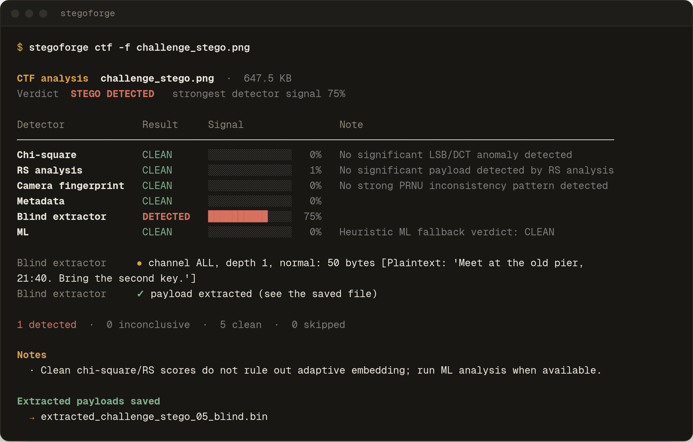
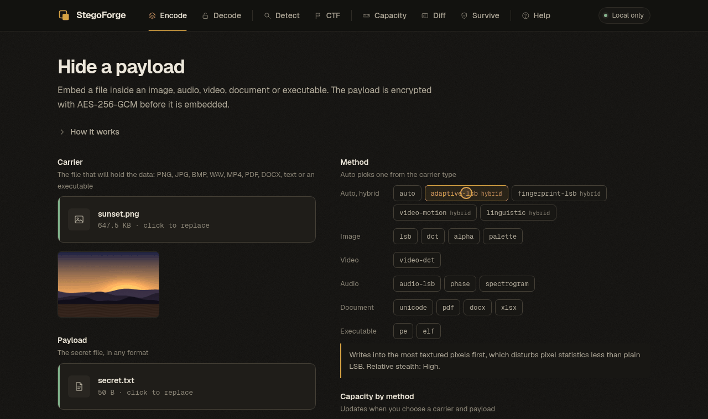
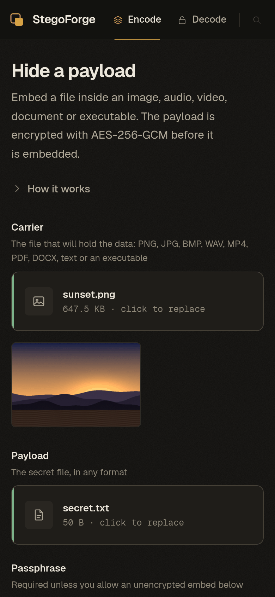

<div align="center">


# StegoVault

**Hide encrypted data in images, audio, video, documents and executables.<br>Find it again, or find what someone else hid.**

[](https://pypi.org/project/stegovault/)
[](https://pypi.org/project/stegovault/)
[](https://github.com/46501/steganalysis/actions/workflows/ci.yml)
[](LICENSE)
[](https://github.com/46501/steganalysis/releases)



<sub>A real recording of the local web UI (<code>stegovault web</code>): hide a file, extract it, run the detectors.</sub>

</div>

---

## Why StegoVault

- **Both sides of the problem.** Embed a payload *and* analyse a suspicious file with the same tool: 20 embedding methods, 11 detectors, one-command CTF mode.
- **Encrypted before it is hidden.** Every payload is sealed with AES-256-GCM under an Argon2id key. A payload that is found still cannot be read without the passphrase.
- **Honest about limits.** Steganography is statistical, not magic. Detectors say *inconclusive* when they cannot tell, docs list what each method does **not** survive, and measured numbers are published with their error bars ([`docs/DETECTOR-EVAL.md`](docs/DETECTOR-EVAL.md)).
- **Local by default.** The web UI listens on loopback only and makes no request to any third party; `--offline` switches the network off entirely; StegoVault never downloads an executable or a model.
- **Scriptable.** Every command has `--json`; errors go to stderr with stable codes, so stdout stays clean for pipes.

## Install

| You are on | Do this |
|---|---|
| **Any OS, Python 3.10+** | `pipx install stegovault` (add the browser UI with `pipx install "stegovault[web]"`) |
| **Debian, Ubuntu, Kali** | Download the `.deb` from [Releases](https://github.com/46501/steganalysis/releases), then `sudo apt install ./stegovault_*_all.deb` (uses your system Python libraries and installs a man page) |
| **No Python, just a binary** | Download `stegovault-linux-x86_64`, `stegovault-macos-arm64` or `stegovault-windows-x86_64.exe` from [Releases](https://github.com/46501/steganalysis/releases) |
| **Docker** | `docker build -t stegovault .` then `docker run -p 5000:5000 stegovault` (the UI is token-protected; the token is in `docker logs`) |
| **From source** | `git clone https://github.com/46501/steganalysis && cd steganalysis && pip install -e ".[web]"` |

Then check the installation:

```console
$ stegovault doctor
```



`doctor` lists what this machine can and cannot do (video support, FFmpeg for MP3/FLAC/OGG, the bundled ML model) and never touches the network.

> **Python 3.10:** it works, but Pillow's image-decoder fixes (24 advisories in 12.3.0, patched in 13.0.0) need Python 3.11 or newer. Use Python 3.11+ when you analyse files you do not trust.

## A one-minute tour



```bash
# Keep the passphrase out of your shell history and `ps` (a plain -k works, with a warning)
export STEGOVAULT_KEY="a long passphrase, not a short one"

stegovault encode -c photo.png -p secret.txt        # method picked from the carrier type
stegovault decode -f photo_stego.png                # -> photo_decoded.txt

stegovault capacity -c photo.png --depth 2          # how much fits, and how stealthy each method is
stegovault diff -c photo.png -s photo_stego.png     # heatmap of exactly which pixels changed
stegovault detect -f photo_stego.png                # run the detectors on a file
stegovault ctf -f challenge.png                     # every detector + extraction, one ranked report

# Will it survive an upload? Simulates the platform's recompression locally and tries to extract.
stegovault encode -c photo.png -p secret.txt --target twitter --test-survival

# The same secret into every carrier in a folder
stegovault batch -d ./carriers -p secret.txt --jobs 4

stegovault web                                      # the local web UI on http://localhost:5000
```

> An unencrypted payload (`--allow-plaintext`) is refused unless you ask for it. That is on purpose: without a key the embedded bytes are readable by anyone who extracts them, and the **CTF** scene in the recording above shows how easily that happens.

### Interactive menu

Run `stegovault` with no arguments for a guided menu (it opens with the boot screen above). `STEGOVAULT_FAST_UI=1` skips the animation for instant starts, and `STEGOVAULT_UI_STAGE_DELAY=0.4` tunes its pacing.

## What it can hide where

| Carrier | Methods | Good to know |
|---|---|---|
| **PNG, BMP, TIFF, WebP** | `lsb`, `adaptive-lsb`, `fingerprint-lsb`, `alpha` | Pixel LSBs are destroyed by lossy re-compression. `adaptive-lsb` writes into busy pixels first, which disturbs statistics less; `fingerprint-lsb` is camera-noise aware |
| **JPEG** | `dct` | Works in the frequency domain and keeps the output a JPEG. In the local `survive` simulation (1200×780 photo, 50 B payload) it survived 7 of 10 platform profiles; JPEG quality of about 80 and below (WhatsApp, Facebook, TikTok) destroyed it |
| **GIF, indexed PNG** | `palette` | A few bytes of capacity: too small for an encrypted payload (the envelope alone is 50 bytes) |
| **WAV, FLAC, MP3, OGG** | `audio-lsb`, `phase`, `spectrogram` | Output is WAV. `spectrogram` is a visual watermark, not a byte channel. MP3/FLAC/OGG input needs FFmpeg |
| **MP4, WebM** | `video-dct`, `video-motion` | Written as **lossless H.264**: files are large, play in ffmpeg-based players (VLC, mpv) rather than most browsers, and any later re-encode destroys the payload. Audio is kept. The encoder verifies its own output |
| **TXT, PDF, DOCX, XLSX** | `unicode`, `linguistic`, `pdf`, `docx`, `xlsx` | Zero-width characters, synonym substitution, or data the viewer ignores |
| **ELF, PE (EXE, DLL)** | `elf`, `pe` | Slack space; a stego'd binary still runs, but a signed PE loses its signature |
| **Network traces** | `tcp-covert`, `timing-covert` | Experimental: trace-file mode, or live send/capture with root and an explicit acknowledgement |

Every method, its capacity formula and what it survives is in [`docs/METHODS.md`](docs/METHODS.md).

## Security model

- **Crypto.** AES-256-GCM; key from Argon2id (3 passes, 64 MiB, 2 lanes) with a fresh salt and nonce per embed. The envelope is bound to the embedding method and authenticates its own padding flag, so a payload cannot be replayed into another method or have its padding rewritten.
- **One generic failure.** A wrong passphrase, a damaged file and a file with nothing hidden in it all give the same error, with a stable machine code (`decryption-failed`).
- **No fixed bytes on request.** `--no-magic` embeds with no identifying header at all. `--pad-to` hides the payload length.
- **Deniability.** `--decoy` stores two payloads under two keys; both slots are the same size and header-less. It protects against someone who has only the file, not against someone who can compel both keys.
- **Compatible with the past.** Payloads, decoy containers and key-exchange files written by StegoVault/StegoForge ≤ 1.1.5 still open (a distinct KDF profile is kept for them; checked by creating files with the real 1.1.5 release), and `--require-v2` refuses them if you want that. The reverse is not true: 1.1.5 cannot open files made by 1.5.
- **What it does not do.** It cannot make an image statistically perfect, survive lossy re-encoding, or protect a compromised machine. The passphrase also sets the order samples are visited in, which is obfuscation rather than a second layer of encryption.

The full list of what is and is not protected: [`docs/THREAT-MODEL.md`](docs/THREAT-MODEL.md).

## Detect and CTF mode



| Detector | Looks for |
|---|---|
| **Chi-square** | Pixel-value pairs that look artificially equal, as after LSB embedding. Reports *inconclusive* for noise-like images, where clean files look equalised too |
| **RS analysis** | The fraction of pixels whose low bits were rewritten |
| **Metadata** | Anomalies in EXIF, XMP, PNG chunks, PDF and Office properties |
| **Blind extractor** | Tries the common parameter combinations and recovers payloads in StegoVault's own layout |
| **Camera fingerprint** | Broken sensor-noise (PRNU) consistency in photographs |
| **Binary** | Non-zero data in padding that linkers leave empty (ELF, PE) |
| **ML** | A bundled ONNX model with a heuristic fallback: a hint, never a verdict |
| **Media checks** | Video, audio, PDF and Office anomaly scans; an unkeyed video payload is extracted and reported |

**Results are indicators, not proof.** On the small bundled test corpus chi-square and RS miss most small payloads, and the blind extractor cannot see keyed embeds at all ([measurements and caveats](docs/DETECTOR-EVAL.md)). A clean or inconclusive result never proves a file is clean.

## The web UI & Production Authentication

<table>
  <tr>
    <td width="62%"></td>
    <td width="38%"></td>
  </tr>
</table>

`stegovault web` serves the full StegoVault suite with a complete, production-ready authentication and personalized workspace system:

- **Full User Authentication:** Secure account creation, sign-in, remember-me persistence, single-use cryptographically hashed password recovery, and email verification.
- **Argon2id & HttpOnly Sessions:** Passwords hashed with state-of-the-art Argon2id ($m=65536, t=3, p=4$); sessions stored in tamper-proof HttpOnly, SameSite cookies with SHA-256 session token hashing.
- **Personalized Dashboard:** Live telemetry showing total operations, carrier encoding counts, payload extractions, and forensic detections backed by real database records.
- **Account & Security Settings:** Update full name and username, change password with credential verification, inspect and revoke active sessions, or permanently delete account data.
- **Privacy-First Telemetry:** The database logs only high-level metadata (operation type, carrier basename, status, timestamp). Secret passphrases, encryption keys, and payload contents are **never** stored or logged.
- **Production-Ready Persistence:** Powered by SQLite with Write-Ahead Logging (WAL), foreign key cascading, and sliding-window rate limiting against brute-force login attacks. See [`.env.example`](.env.example) for configuration options.
- **Host & Origin Defense:** DNS rebinding protection, cross-site form post validation, rate limiting, and zero third-party font or analytics leakage.
- **Responsive Cybersecurity UI:** Dark navy and electric teal theme, accessible keyboard navigation, mobile drawer support, and high-DPI branding.

## Command line reference

| Command | Does |
|---|---|
| `encode`, `decode` | Hide / extract a payload. `--method`, `--depth 1-4`, `--decoy`, `--wet-paper`, `--no-magic`, `--pad-to`, `--target`, `--test-survival`, `--key-file` |
| `detect`, `ctf` | Run detectors (`--chi2 --rs --exif --blind --ml --fingerprint --binary`, or `--all`) / the full ranked report. `--stdin`, `--case-id`, `--no-save` |
| `capacity`, `diff` | How much a carrier holds per method / what changed between two files |
| `survive` | Simulate a platform's recompression and test extraction (10 profiles) |
| `batch` | Embed into every compatible carrier in a directory (`--jobs`) |
| `web` | The local web UI (`--port`, `--host`) |
| `deadrop post / check / monitor` | Move a carrier through an HTTP drop; `keyx initiate / complete` for an X25519 key exchange |
| `doctor`, `init` | Check the installation / install the bundled model |
| `schema`, `completion`, `update` | JSON output schemas / bash, zsh, fish completion generated from the live command tree / self-update check |

Conventions scripts can rely on:

- `--json` prints exactly one JSON document on stdout. Errors are `{"status": "error", "message": …, "code": …}`.
- Human-readable errors and warnings go to **stderr** (`error …`, then a `hint …` line); exit status is `1` on error.
- `STEGOVAULT_KEY` supplies the passphrase; `--offline` / `STEGOVAULT_OFFLINE=1` disables all network access.
- `stegovault COMMAND --help` for flags, `man stegovault` after a `.deb` install, `stegovault schema --json` for the JSON Schema of every `--json` output.

```bash
eval "$(stegovault completion bash)"                    # bash
stegovault completion zsh > "${fpath[1]}/_stegovault"   # zsh
stegovault completion fish | source                     # fish
```

<details>
<summary><b>Dead drops and key exchange</b></summary>

```bash
stegovault deadrop post  -c cover.png -p msg.txt -k "shared key" --upload-url https://…
stegovault deadrop check --url https://example.com/cover.png -k "shared key"   # payload lands in the current directory
stegovault deadrop monitor --url https://example.com/cover.png -k "shared key" --interval 30

stegovault deadrop keyx initiate -c a.png -o a_out.png     # prompts for the private-key-file passphrase
stegovault deadrop keyx complete -f b_out.png --output-key-file session.key
```

Key exchange is X25519 with a session key bound to both public keys (`--legacy-v1` reproduces StegoVault/StegoForge ≤ 1.1.5's session key exactly, for a peer that has not upgraded); add Ed25519 signatures with `--sign-key-file` / `--verify-key-file` to authenticate the peer. Network requests refuse private and loopback addresses unless explicitly allowed. Use these only on systems and accounts you are authorised to use.

</details>

<details>
<summary><b>Use it as a library</b></summary>

```python
from core.crypto import aes
from core.image.lsb import LSBEncoder

sealed  = aes.encrypt_envelope(b"secret", "a long passphrase", method="lsb")   # AES-256-GCM, bound to the method
stego   = LSBEncoder().encode(open("photo.png", "rb").read(), sealed, depth=1)
sealed2 = LSBEncoder().decode(stego, depth=1)
assert aes.decrypt_envelope(sealed2, "a long passphrase", method="lsb") == b"secret"
```

Encoders embed the bytes they are given; encryption is a separate step (`stegoforge_ops.op_encode` / `op_decode` do both, with the same policy as the CLI). Every encoder implements `core.base.BaseEncoder` and raises `ValueError` (or a subclass such as `CorruptedCarrierError`) for bad input, never a raw parser exception. See [`docs/API.md`](docs/API.md).

</details>

## Troubleshooting

| Symptom | Likely cause |
|---|---|
| `Failed to decode payload` | Wrong passphrase, wrong method, or the file was re-saved or re-uploaded (lossy compression rewrites the bits). Try `--method`, and test the route with `stegovault survive` first |
| `Encrypted payload too large` | Check `stegovault capacity -c FILE`; the message lists a larger depth, `adaptive-lsb`, or a bigger carrier |
| Video output will not play in the browser | Lossless H.264 uses the High 4:4:4 Predictive profile: use VLC or mpv |
| `stegovault web` says dependencies are missing | `pip install "stegovault[web]"` |
| MP3 / FLAC / OGG carriers fail | Install FFmpeg (`sudo apt install ffmpeg`) or set `STEGOVAULT_FFMPEG` |
| Anything else | `stegovault doctor` |

## Development

```bash
pip install -e ".[web]" pytest
python -m pytest tests/ -q                      # 400+ tests: crypto, every encoder, detectors, CLI, web, packaging

uvx ruff check core detect protocol web stegoforge.py stegoforge_ops scripts
uvx --with-requirements requirements.txt mypy core detect protocol stegoforge_ops --ignore-missing-imports

# in a real browser (needs Chrome and Playwright): encode, download, decode, detect, keyboard, phone layout
uvx --with playwright --with pillow --with numpy python scripts/ui_smoke.py

python -m build && python scripts/check_dist.py dist/*     # wheel + sdist, verified to contain the program
python scripts/build_deb.py --out dist-deb                 # Debian package
python scripts/make_readme_media.py                        # regenerate the screenshots and GIFs above from the real program
```

CI runs the suite on Python 3.10 and 3.12, lint, types, a blocking dependency audit (on 3.12, see the note under Install), the distribution checks, and installs the built `.deb` with `apt`. Dependencies are locked for the whole supported range in `requirements.hash.lock` (`scripts/compile_lock.sh` regenerates it).

<details>
<summary><b>Project layout</b></summary>

```text
stegoforge.py        CLI entry point (Typer): commands and rendering (stegovault / stegoforge)
stegoforge_ops/      the operation layer shared by CLI and web: encode, decode, detect, capacity, batch, UI helpers, completion
core/
  crypto/            AES-256-GCM envelopes, Argon2id profiles, decoy containers, keyed traversal
  image/ audio/ video/ document/ binary/ network/   one module per method, all subclassing core.base.BaseEncoder
  bits.py errors.py config.py guess.py http.py       shared helpers: bit packing, typed errors, limits, payload sniffing, SSRF-safe client
detect/              the detectors
protocol/            dead drops, X25519 key exchange
web/                 Flask app, template, script, stylesheet and self-hosted fonts
models/              the bundled ONNX model and its checksum
docs/                methods, threat model, detector evaluation, API and error references, man page
scripts/             lock, SBOM, .deb, dist check, UI smoke test, media generator
tests/
```

</details>

## Documentation

[`METHODS`](docs/METHODS.md) · [`THREAT-MODEL`](docs/THREAT-MODEL.md) · [`DETECTOR-EVAL`](docs/DETECTOR-EVAL.md) · [`MODEL-CARD`](docs/MODEL-CARD.md) · [`PROTOCOL`](docs/PROTOCOL.md) · [`OFFLINE`](docs/OFFLINE.md) · [`API`](docs/API.md) · [`ERRORS`](docs/ERRORS.md) · [`OPENAPI`](docs/OPENAPI.md) · [`CHANGELOG`](CHANGELOG.md)

## Responsible use

StegoVault is built for digital-forensics research, CTF competitions, privacy work and authorised security testing. Hiding unlawful content, exfiltrating data you are not entitled to take, or evading lawful oversight is illegal in most places, and the covert-channel and dead-drop features must only be used on systems you own or are explicitly authorised to test. The software is provided as is, without warranty (see [LICENSE](LICENSE)).

## Contributing

Issues and pull requests are welcome; [`CONTRIBUTING.md`](CONTRIBUTING.md) has the details. A new method subclasses `BaseEncoder`, honours its error contract, documents its capacity and what it does not survive in `docs/METHODS.md`, and comes with tests that round-trip a real carrier. Run the checks above before opening a PR. Please follow the [Code of Conduct](CODE_OF_CONDUCT.md), and report security problems privately as described in [`SECURITY.md`](SECURITY.md), not in a public issue.

<div align="center">
  <sub>MIT licensed · built by <a href="https://github.com/Nour833">Nour833</a></sub>
</div>
